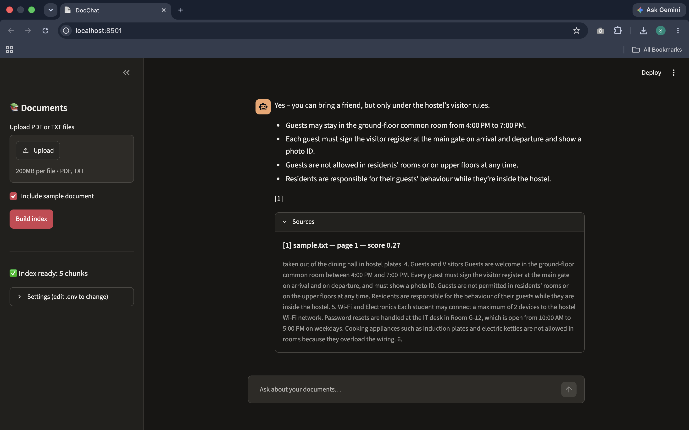

# DocChat — Chat With Your PDFs Using RAG


   

Ask questions about your own PDFs and text files and get answers **with page citations**, powered by a technique called **Retrieval-Augmented Generation (RAG)**.

This project is deliberately built **without** LangChain or LlamaIndex. Every step (reading files, splitting text, turning text into vectors, searching, prompting the LLM) is a small, readable Python file, so you can see exactly what happens under the hood.

## Features

- **Answers with citations:** every answer points to the file and page it came from.
- **Semantic search:** finds relevant passages by meaning, not just matching words, using sentence embeddings and cosine similarity.
- **Hallucination guardrail:** if no passage is relevant enough, the app says so and never calls the LLM.
- **PDF and TXT support:** upload files in the web app or index folders from the command line.
- **Cloud or fully offline:** runs GPT-OSS-20B on Groq, or a local model through Ollama, with no code changes.
- **Web app and CLI:** a Streamlit chat interface, plus terminal commands with a `--show-context` debug mode.
- **Tested and measured:** unit tests with mock models run on every push via GitHub Actions, and an evaluation script reports retrieval accuracy.

---

## Table of contents

1. [Demo](#1-demo)
2. [Quick start](#2-quick-start)
3. [Project structure](#3-project-structure)
4. [The big picture](#4-the-big-picture)
5. [Under the hood, step by step](#5-under-the-hood-step-by-step)
6. [One question, fully traced](#6-one-question-fully-traced)
7. [Configuration reference](#7-configuration-reference)
8. [Using the CLI](#8-using-the-cli)
9. [Testing](#9-testing)
10. [Troubleshooting](#10-troubleshooting)
11. [Design decisions and trade-offs](#11-design-decisions-and-trade-offs)
12. [Limitations](#12-limitations)
13. [Next steps](#13-next-steps)
14. [Glossary](#14-glossary)

---

## 1. Demo

The repo ships with `data/sample.txt`, a short **fictional** hostel handbook. After indexing it:

```text
You:      What time is the curfew on Saturday?
DocChat:  The curfew on Saturday is 11:30 PM [1].
          Sources: [1] sample.txt, page 1 (score 0.71)

You:      Can I bring a friend over?
DocChat:  Yes. Guests are allowed in the common room between 4 PM and 7 PM,
          and they must sign the register at the gate [1].

You:      Who won the 2011 Cricket World Cup?
DocChat:  I couldn't find anything about that in your documents.
```

Notice the second question: the handbook never uses the word "friend"; it says "guests". Plain keyword search would miss it. **Semantic search** finds it because the *meanings* are close. The third question shows the app refusing to make things up.

(Exact scores and wording will vary slightly by model.)

---

## 2. Quick start

### Prerequisites

- Python **3.10 or newer** (3.11 recommended)
- About 1 GB of free disk space (PyTorch + the embedding model)
- **One** LLM backend:
  - **Option A, Groq (cloud, free tier, fastest to set up):** create an API key at <https://console.groq.com>
  - **Option B, Ollama (100% local, no key, no internet after setup):** install from <https://ollama.com>, then run `ollama pull llama3.2`

### Install

```bash
git clone https://github.com/satyarjs/docchat.git
cd docchat

python -m venv .venv
# macOS / Linux
source .venv/bin/activate
# Windows (PowerShell)
.venv\Scripts\Activate.ps1

# Tip: install the CPU-only PyTorch first. On Linux the default wheel bundles
# CUDA and is several GB larger. Skip this line if you have an NVIDIA GPU.
pip install torch --index-url https://download.pytorch.org/whl/cpu

pip install -r requirements.txt
```

### Configure

```bash
cp .env.example .env      # Windows: copy .env.example .env
```

Open `.env` and pick one backend:

```ini
# Option A: Groq
LLM_BASE_URL=https://api.groq.com/openai/v1
LLM_API_KEY=gsk_your_key_here
LLM_MODEL=openai/gpt-oss-20b

# Option B: Ollama (comment out Option A)
# LLM_BASE_URL=http://localhost:11434/v1
# LLM_API_KEY=ollama
# LLM_MODEL=llama3.2
```

> Model names change over time. If you get a "model not found" error, check the provider's current list: for Groq, `GET https://api.groq.com/openai/v1/models` or the models page in their docs; for Ollama, `ollama list`.

### Run

```bash
# Web UI
streamlit run app.py

# Or the terminal
python cli.py ingest data/
python cli.py ask "What time is the curfew on Saturday?"
```

The **first run downloads the embedding model** (~90 MB) into your Hugging Face cache (`~/.cache/huggingface`). After that it works offline (with Ollama, the whole app works offline).

### Run the tests

```bash
pip install -r requirements-dev.txt
pytest -q
```

Tests use fake embedders and fake LLMs, so they need **no API key, no internet and no model download**.

---

## 3. Project structure

```text
docchat/
├── README.md               ← you are here
├── requirements.txt        ← dependencies (pulls CPU-only PyTorch)
├── requirements-dev.txt    ← development tools (pytest)
├── .env.example            ← copy to .env and fill in
├── .gitignore              ← ignores .env, storage/, .venv/, uploads
├── LICENSE                 ← MIT license
├── app.py                  ← Streamlit web UI (upload, index, chat)
├── cli.py                  ← terminal interface: `ingest` and `ask`
├── eval.py                 ← pass/fail scorecard on the sample handbook
├── .github/workflows/
│   └── tests.yml           ← runs pytest on GitHub for every push
├── docchat/                ← the actual library; UI-agnostic
│   ├── __init__.py
│   ├── config.py           ← reads .env into a typed Settings object
│   ├── schema.py           ← dataclasses: Page, Chunk, SearchResult, Answer, IngestReport
│   ├── loader.py           ← PDF/TXT files → list[Page]
│   ├── chunker.py          ← Pages → overlapping Chunks
│   ├── embedder.py         ← text → normalized vectors (sentence-transformers)
│   ├── vector_store.py     ← stores vectors, cosine search, save/load to disk
│   ├── prompts.py          ← system prompt + context formatting
│   ├── llm.py              ← talks to any OpenAI-compatible chat API
│   └── pipeline.py         ← DocChat class: glues everything (ingest, ask)
├── data/
│   └── sample.txt          ← fictional hostel handbook for the demo
├── storage/                ← generated index (gitignored)
│   ├── vectors.npy
│   ├── chunks.json
│   └── meta.json
└── tests/
    ├── conftest.py         ← FakeEmbedder, FakeLLM fixtures
    ├── test_config.py
    ├── test_chunker.py
    ├── test_vector_store.py
    └── test_pipeline.py
```

**The one rule of this layout:** everything inside `docchat/` knows nothing about Streamlit or the terminal. `app.py` and `cli.py` are thin "front doors" that call the same `DocChat` class. That's why the library is easy to test, and why you could add a FastAPI server later without touching the core.

### Suggested reading order

Read the code in the order data flows through it: `schema.py` → `loader.py` → `chunker.py` → `embedder.py` → `vector_store.py` → `prompts.py` → `llm.py` → `pipeline.py` → `cli.py` → `app.py`. Every file is short and opens with a docstring explaining its job in the pipeline.

### Dependency map (who imports whom)

```text
app.py ─┐
        ├──► pipeline.py ──► loader.py ──────► schema.py
cli.py ─┘         │      ──► chunker.py ─────► schema.py
                  │      ──► embedder.py
                  │      ──► vector_store.py ► schema.py
                  │      ──► prompts.py ─────► schema.py
                  │      ──► llm.py
                  └──────► config.py
```

Arrows only point "down". No module imports `pipeline.py` except the front doors, so there are no circular imports.

---

## 4. The big picture

An LLM only knows what was in its training data. It has never seen *your* hostel handbook, lecture notes or company policy. RAG fixes this without retraining anything: **find the relevant pieces of your documents first, then paste them into the prompt** and ask the LLM to answer using only those pieces.

There are two phases.

### Phase 1: Indexing (runs once per set of documents)

```text
 ┌──────────┐   ┌──────────┐   ┌──────────┐   ┌──────────────┐   ┌──────────────┐
 │ PDF/TXT  │──►│  Pages   │──►│  Chunks  │──►│   Vectors    │──►│ Vector store │──► storage/
 │  files   │   │ (text +  │   │ (~800    │   │ (384 numbers │   │ (NumPy matrix│
 │          │   │ page no.)│   │  chars)  │   │  per chunk)  │   │  + metadata) │
 └──────────┘   └──────────┘   └──────────┘   └──────────────┘   └──────────────┘
   loader.py                    chunker.py      embedder.py        vector_store.py
```

### Phase 2: Querying (runs for every question)

```text
 "Can I bring a friend over?"
            │
            ▼
   ┌─────────────────┐   ┌──────────────────┐   ┌───────────────┐   ┌───────────┐
   │ Embed question  │──►│ Find top-k most  │──►│ Build prompt: │──►│    LLM    │──► answer + [1] citations
   │ (same model!)   │   │ similar chunks   │   │ rules+context │   │ (Groq or  │
   └─────────────────┘   │ (cosine search)  │   │ + question    │   │  Ollama)  │
       embedder.py       └──────────────────┘   └───────────────┘   └───────────┘
                           vector_store.py        prompts.py           llm.py
                                  │
                                  └── nothing scores above MIN_SCORE?
                                      → reply "couldn't find it", skip the LLM entirely
```

The key insight: **the LLM never searches your documents.** Retrieval is done by plain math on vectors. The LLM only reads the handful of chunks we hand it and writes a nice answer.

---

## 5. Under the hood, step by step

### 5.1 Loading: files → `Page` objects (`loader.py`)

```python
@dataclass
class Page:
    source: str        # file name, e.g. "handbook.pdf"
    page_number: int   # 1-based, as a human would count
    text: str
```

- **PDFs** are read with `pypdf`. For each page we call `page.extract_text()`.
- **`.txt` files** become a single `Page` with `page_number=1`.
- Whitespace is normalized (runs of spaces and newlines collapse to single spaces) and empty pages are dropped.

**Why keep the page number?** Because it travels with the text all the way to the final answer, which is how we can say "page 3" in a citation. Metadata you throw away early can never come back.

**What a PDF really is:** a PDF doesn't store "paragraphs"; it stores instructions like "draw these glyphs at these coordinates". `extract_text()` reconstructs reading order heuristically, so tables, multi-column layouts and headers can come out jumbled. **Scanned PDFs** are images of text and contain no text at all: `extract_text()` returns an empty string. The loader warns you when a PDF yields no text (the fix is OCR; see [Next steps](#13-next-steps)).

### 5.2 Chunking: `Page` → overlapping `Chunk`s (`chunker.py`)

```python
@dataclass
class Chunk:
    id: str            # "handbook.pdf:p3:c0" → file, page, chunk index
    text: str
    source: str
    page_number: int
```

Each page's text is cut into windows of about `CHUNK_SIZE=800` characters, with each new window starting `CHUNK_SIZE - CHUNK_OVERLAP = 650` characters after the previous one:

```text
page text:  |──────────────────────────────────────────────────────────────|
chunk 0:    |─────────── 800 ───────────|
chunk 1:                      |─────────── 800 ───────────|
chunk 2:                                        |─────────── 800 ─────────|
                              |◄── 150 ──►| overlap
```

To avoid cutting words in half, the chunker moves each cut back to the nearest sentence end (`. `, `? `, `! `) or, failing that, the nearest space, as long as that doesn't shrink the chunk below half its target size.

**Why chunk at all?** Three reasons:

1. **The embedding model has an input limit.** `all-MiniLM-L6-v2` reads at most 256 tokens (word pieces) and *silently ignores the rest*. 800 characters of English is roughly 150–200 tokens, which fits safely.
2. **One vector per huge text is blurry.** A vector for an entire 20-page PDF is an average of everything in it and matches nothing well. A vector for one paragraph is sharp.
3. **The LLM's context window is limited and costs tokens.** We want to send it the 4 most relevant paragraphs, not the whole book.

**Why overlap?** If the answer sits across a cut ("…students must return by / 10:30 PM on weekdays…"), neither chunk alone holds the full sentence. With 150 characters of overlap, a sentence near a boundary appears whole in at least one chunk.

**Why chunk per page instead of per document?** So every chunk belongs to exactly one page and citations stay accurate. The trade-off: a sentence spanning a page break gets split. That's an acceptable trade-off for accurate citations.

**Tuning intuition:** smaller chunks give more precise retrieval but less context per chunk; larger chunks give more context but fuzzier matches. 500–1000 characters is a sensible starting range for prose.

### 5.3 Embeddings: text → vectors (`embedder.py`)

An **embedding model** is a neural network that converts a piece of text into a fixed-length list of numbers (a vector) such that **texts with similar meaning get vectors that point in similar directions**.

We use `sentence-transformers/all-MiniLM-L6-v2`:

| Property | Value | Why it matters |
| --- | --- | --- |
| Output size | 384 numbers per text | Small → fast search, little memory |
| Model size | ~90 MB | Downloads quickly, runs on any laptop CPU |
| Max input | 256 tokens | Why our chunks are ~800 chars |
| Cost | Free, runs locally | No API key needed for this step |

```python
vectors = model.encode(texts, normalize_embeddings=True)   # shape (n, 384), float32
```

**What's going on inside the model, in one paragraph:** the text is split into tokens, each token gets an initial vector, and 6 Transformer layers let every token's vector "look at" every other token's vector (self-attention) and update itself based on context; that's how "bank" ends up different in "river bank" and "bank loan". Finally all token vectors are averaged (mean pooling) into one 384-number vector for the whole text. The model was trained on hundreds of millions of sentence pairs (question ↔ answer, title ↔ body, paraphrase ↔ paraphrase) to pull related pairs close together and push unrelated ones apart.

**Intuition:** think of each of the 384 numbers as a score on some learned "direction of meaning". No single number is human-readable, but together they place the text at a point in a 384-dimensional space where "guests are allowed in the common room" lands near "can I bring a friend over".

**Why `normalize_embeddings=True`?** It scales every vector to length 1. Then cosine similarity (next section) becomes a plain dot product, which is simpler and faster.

**The golden rule:** the question **must** be embedded with the **same model** as the chunks. Vectors from different models live in different spaces; comparing them is like comparing GPS coordinates with pin codes. That's why `meta.json` records the model name and loading refuses a mismatch.

### 5.4 The vector store: storing and searching (`vector_store.py`)

The "vector database" here is just:

- a NumPy matrix `vectors` of shape `(num_chunks, 384)`, and
- a Python list `chunks` where `chunks[i]` is the metadata for row `i`.

**Cosine similarity** measures the angle between two vectors:

```text
cos(a, b) = (a · b) / (|a| × |b|)
```

- `1.0` → same direction (very similar meaning)
- `0.0` → unrelated
- negative → opposite-ish (rare for sentence embeddings)

Because all our vectors have length 1, `|a| × |b| = 1`, so **cosine similarity = dot product**.

**Tiny worked example in 2D** (real vectors have 384 dimensions, but the maths is identical):

```text
question q = [0.6, 0.8]
chunk A    = [0.8, 0.6]    q·A = 0.6×0.8 + 0.8×0.6 = 0.96  ← very similar
chunk B    = [-0.6, 0.8]   q·B = 0.6×(-0.6) + 0.8×0.8 = 0.28  ← weakly related
```

**Searching every chunk at once** is one matrix–vector multiplication:

```python
scores = self.vectors @ query_vector           # shape (num_chunks,) — one score per chunk
top = np.argsort(-scores)[:k]                  # indices of the k highest scores
```

This is called **brute-force (exact) search**: it compares the question against *every* chunk. That sounds slow, but:

- 10,000 chunks × 384 dims ≈ 3.8 million multiply-adds, which NumPy finishes in a few milliseconds.
- Memory: 384 floats × 4 bytes ≈ 1.5 KB per chunk, so 10,000 chunks ≈ 15 MB.

Dedicated vector databases (FAISS, Chroma, pgvector, Qdrant) use *approximate* nearest-neighbour indexes (like HNSW graphs) that only pay off at hundreds of thousands to millions of vectors. For a personal document collection, a NumPy matrix is honest, fast and fully understandable.

**Persistence:** `save()` writes three files to `storage/`:

| File | Contents |
| --- | --- |
| `vectors.npy` | The raw float32 matrix (NumPy's binary format) |
| `chunks.json` | Text + source + page for every row, in the same order |
| `meta.json` | Embedding model name, vector dimension, chunk count, creation time |

Row `i` of `vectors.npy` always corresponds to item `i` in `chunks.json`. That alignment is the entire "database".

### 5.5 Retrieval: choosing what the LLM gets to see (`pipeline.py`)

1. Embed the question → a 384-number vector.
2. Score it against every chunk; keep the **top `TOP_K=4`**.
3. Drop any chunk scoring below **`MIN_SCORE=0.25`**.
4. **If nothing survives, stop.** Return "I couldn't find anything about that in your documents" **without calling the LLM.**

Step 4 is a cheap but powerful guardrail: an unrelated question ("Who won the 2011 World Cup?") scores low against a hostel handbook, so the LLM never gets a chance to answer from its general knowledge, and you save an API call.

**Why top-k = 4?** Enough to cover answers spread across a couple of places; few enough to keep the prompt short and focused. More context isn't always better: irrelevant chunks can distract the model.

**Why 0.25?** It's an empirical starting point for MiniLM. Use `python cli.py ask "..." --show-context` to see real scores for your documents and tune it.

### 5.6 Prompt construction (`prompts.py`)

The retrieved chunks are numbered and pasted into the prompt. Here is **exactly** what the LLM receives for "Can I bring a friend over?":

```text
[system]
You are DocChat, an assistant that answers questions using ONLY the provided context
from the user's documents.
Rules:
1. Use only the information in the context. Do not use outside knowledge.
2. Cite every factual claim with the matching source number in square brackets, like [1] or [2].
3. If the context does not contain the answer, say: "I couldn't find that in your documents."
4. Be concise. Prefer short paragraphs or bullet points.

[user]
Context:
[1] (sample.txt, page 1)
Guests are welcome in the ground-floor common room between 4:00 PM and 7:00 PM.
Every guest must sign the visitor register at the main gate...

[2] (sample.txt, page 1)
...

Question: Can I bring a friend over?
```

**Anatomy of this prompt:**

- **System message** sets the rules for the whole conversation. LLMs are trained to weight it highly.
- **Numbered context** gives the model short labels (`[1]`, `[2]`) to cite, and lets our code map them back to file + page.
- **"Use only the context"** + **an explicit fallback sentence** is called *grounding*. It greatly reduces (but does not eliminate) hallucination.
- **Question last:** models pay strong attention to the end of the prompt, so the actual task goes there.

### 5.7 The LLM call (`llm.py`)

Both Groq and Ollama speak the **OpenAI-compatible Chat Completions API**, so we use the official `openai` Python package and only change the base URL:

```python
client = OpenAI(base_url=settings.llm_base_url, api_key=settings.llm_api_key)
response = client.chat.completions.create(
    model=settings.llm_model,
    messages=messages,
    temperature=0.2,
    max_tokens=2048,
)
answer = response.choices[0].message.content
```

Under the hood this is just an HTTP request:

```text
POST {LLM_BASE_URL}/chat/completions
Authorization: Bearer {LLM_API_KEY}
Content-Type: application/json

{"model": "openai/gpt-oss-20b",
 "messages": [{"role": "system", "content": "..."}, {"role": "user", "content": "..."}],
 "temperature": 0.2,
 "max_tokens": 2048}
```

…and the JSON response contains `choices[0].message.content` (the answer) and `usage` (token counts).

**What the LLM does with it:** it converts the prompt into tokens (≈ 4 characters of English per token), then generates the answer **one token at a time**, each time predicting the most likely next token given everything before it. It has no database, no memory between requests and no access to your files; the context we pasted is the *only* way it knows about your documents.

**Key settings:**

| Setting | Value | Meaning |
| --- | --- | --- |
| `temperature` | `0.2` | Randomness of token choice. Low = focused and repeatable, which is what you want for factual Q&A. |
| `max_tokens` | `2048` | Upper limit on answer length (and cost). |
| Context window | model-dependent | Max tokens of prompt + answer. Our prompt is ~1,000 tokens (4 chunks × ~200 + rules), which fits even small local models. Ollama's default context is small (2048 tokens in many versions), another reason to keep `TOP_K` modest. |

**Friendly errors:** `llm.py` catches the common failures and turns them into plain-English messages: connection refused ("Is Ollama running? Check LLM_BASE_URL"), 401 ("Check LLM_API_KEY"), 404 / model not found ("Check LLM_MODEL against your provider's model list") and rate limits ("Wait a moment and try again").

### 5.8 Citations

The LLM writes `[1]`, `[2]`… The `Answer` object carries the list of `SearchResult`s in the same order, so the UI can show `[1] → sample.txt, page 1, score 0.71` and the exact chunk text. **You can always verify an answer against the source**, which is the whole point of RAG over a plain chatbot.

### 5.9 The UI and Streamlit's execution model (`app.py`)

Streamlit has an unusual execution model: **the entire `app.py` script re-runs from top to bottom on every interaction** (every click, every message). Two tools make that workable:

- **`@st.cache_resource`** wraps the creation of the `DocChat` / embedder object so the 90 MB model loads **once per server process**, not on every rerun.
- **`st.session_state`** is a dictionary that survives reruns; we keep the chat history there.

UI flow:

1. **Sidebar:** upload PDF/TXT files (saved to `data/uploads/`), click **Build index** → `DocChat.ingest()`. Shows files / pages / chunks indexed.
2. On startup, if `storage/` already has an index, it loads automatically.
3. **Chat area:** `st.chat_input` → `DocChat.ask()` → the answer is rendered in `st.chat_message`, with an expandable **Sources** section showing file, page, score and the chunk text.

---

## 6. One question, fully traced

What happens, in order, when you type **"Can I bring a friend over?"** and press Enter:

| # | Where | What happens | Rough time |
| --- | --- | --- | --- |
| 1 | `app.py` | Streamlit reruns the script; `st.chat_input` returns your text | ~ms |
| 2 | `app.py` | Cached `DocChat` instance is reused (no model reload) | ~0 |
| 3 | `pipeline.ask` | Checks the index isn't empty | ~0 |
| 4 | `embedder.embed` | Question → tokens → 6 Transformer layers → mean pool → normalize → `(384,)` vector | 10–50 ms on CPU |
| 5 | `vector_store.search` | `vectors @ q` scores every chunk; `argsort` picks the top 4 | < 5 ms |
| 6 | `pipeline.ask` | Filters by `MIN_SCORE`; the "guests…common room" chunk scores highest | ~0 |
| 7 | `prompts.build_messages` | Builds system + user messages with numbered context | ~0 |
| 8 | `llm.chat` | HTTPS POST to Groq (or localhost to Ollama); model generates ~50 tokens | 0.3–3 s (Groq) / 2–20 s (local, hardware-dependent) |
| 9 | `pipeline.ask` | Wraps text + sources in an `Answer` | ~0 |
| 10 | `app.py` | Renders the answer and the Sources expander; appends to `session_state` history | ~ms |

Takeaway: **almost all the latency is the LLM call.** Retrieval is nearly free.

---

## 7. Configuration reference

All settings live in `.env` and are read by `docchat/config.py`.

| Variable | Default | Description |
| --- | --- | --- |
| `LLM_BASE_URL` | `https://api.groq.com/openai/v1` | Any OpenAI-compatible endpoint. Ollama: `http://localhost:11434/v1` |
| `LLM_API_KEY` | *(required for Groq)* | API key. For Ollama any non-empty string, e.g. `ollama` |
| `LLM_MODEL` | `openai/gpt-oss-20b` | Chat model name at your provider |
| `EMBEDDING_MODEL` | `sentence-transformers/all-MiniLM-L6-v2` | Changing this requires re-indexing |
| `CHUNK_SIZE` | `800` | Target characters per chunk |
| `CHUNK_OVERLAP` | `150` | Characters shared between consecutive chunks; must be at most half of `CHUNK_SIZE` |
| `TOP_K` | `4` | How many chunks to retrieve per question |
| `MIN_SCORE` | `0.25` | Minimum cosine similarity for a chunk to count as relevant |
| `STORAGE_DIR` | `storage` | Where the index is saved |

**Never commit `.env`.** It's in `.gitignore` because it contains your API key.

---

## 8. Using the CLI

```bash
# Index every .pdf and .txt in a folder (rebuilds the index from scratch)
python cli.py ingest data/
# → Indexed 1 file(s), 1 page(s), 5 chunk(s) -> storage/

# Ask a question
python cli.py ask "What are the mess timings?"

# Debug retrieval: print the retrieved chunks and their scores before the answer
python cli.py ask "Can I bring a friend over?" --show-context
```

`--show-context` is the most useful learning tool in the project. Try paraphrased questions, unrelated questions and very short questions, and watch how the scores move.

---

## 9. Testing

```bash
pytest -q
```

AI code is hard to test because real models are slow, random and need network access. The trick is **dependency injection**: `DocChat` accepts an `embedder` and an `llm` in its constructor, so tests pass in fakes:

- **`FakeEmbedder`** turns text into a vector by hashing each word into one of 1,024 buckets and normalizing. Texts that share words get similar vectors. Deterministic, instant, no download.
- **`FakeLLM`** records the messages it received and returns a fixed string. Tests can assert *what the prompt contained* and *whether the LLM was called at all*.

What's covered:

| Test file | Checks |
| --- | --- |
| `test_config.py` | Overlap up to half of the chunk size is accepted; more than half, or negative, is rejected |
| `test_chunker.py` | Chunk sizes, overlap present, no empty chunks, short text → 1 chunk, invalid overlap raises |
| `test_vector_store.py` | Best match ranks first with hand-made vectors, `k` larger than store, save → load round-trip, embedding-model mismatch raises |
| `test_pipeline.py` | End-to-end ingest + ask on a temp folder; context reaches the prompt; off-topic question returns the fallback **without calling the LLM**; asking before ingesting gives a clear error |

---

### Evaluation scorecard (`eval.py`)

Unit tests prove the *code* is correct. `eval.py` proves the *AI system* works on real questions:

```bash
python eval.py              # retrieval only, no API key needed
python eval.py --with-llm   # also checks the final answers (needs .env)
```

It indexes `data/sample.txt` into a temporary folder (your `storage/` is untouched) and reports:

| Metric | What it means |
| --- | --- |
| **Retrieval hit rate @k** | For 8 questions with known answers, how often the chunk containing the answer is in the top-k. Most questions are worded differently from the handbook ("gadgets" vs "devices", "clothes washed" vs "laundry") to prove the search works on meaning. |
| **Correct refusals** | For 3 off-topic questions, how often DocChat refuses without calling the LLM. |
| **Answers with fact + citation** | (`--with-llm`) how often the final answer contains the expected fact and a `[n]` citation. |

If a question fails, run it with `python cli.py ask "..." --show-context`, look at the scores, and tune `MIN_SCORE`, `CHUNK_SIZE` or `TOP_K`. Measuring, then tuning, is how real RAG systems are improved.

### Continuous integration

`.github/workflows/tests.yml` runs `pytest` on GitHub for every push. The tests use fake models, so CI only installs the small packages and finishes in under a minute. The badge at the top of this README shows the latest result.

## 10. Troubleshooting

| Symptom | Likely cause | Fix |
| --- | --- | --- |
| `Connection refused` / `APIConnectionError` | Ollama not running, or wrong URL | Run `ollama serve`; check `LLM_BASE_URL` ends in `/v1` |
| `401 Unauthorized` | Missing or wrong API key | Check `LLM_API_KEY` in `.env`; no quotes or spaces |
| `model not found` / `404` | Model name changed or not pulled | Check provider's model list; for Ollama run `ollama pull <model>` |
| `429 Too Many Requests` | Free-tier rate limit | Wait and retry; ask fewer questions per minute |
| "No text extracted from X.pdf" | Scanned (image) PDF | Use a text-based PDF, or add OCR (see Next steps) |
| Every answer is "couldn't find that" | `MIN_SCORE` too high, or wrong docs indexed | Use `--show-context` to see scores; lower `MIN_SCORE` |
| Answers include irrelevant info | `TOP_K` too high or chunks too large | Lower `TOP_K` or `CHUNK_SIZE` |
| "Index was built with a different embedding model" | You changed `EMBEDDING_MODEL` | Re-run `python cli.py ingest data/` |
| First run is very slow | Downloading the embedding model | One-time; later runs use the cache |
| `pip install` downloads gigabytes | Default PyTorch wheel includes CUDA | Install CPU PyTorch first (see Install) |

---

## 11. Design decisions and trade-offs

| Decision | Why | What you give up |
| --- | --- | --- |
| No LangChain / LlamaIndex | Every step is visible and debuggable; you learn the fundamentals those frameworks wrap | Ready-made integrations (hundreds of loaders and vector DBs) |
| NumPy instead of a vector DB | ~40 lines you can fully read; exact results; fast enough for thousands of chunks | Doesn't scale to millions of vectors; no filtering or concurrent writes |
| Local embeddings (MiniLM) | Free, private, offline, fast on CPU | Lower quality than large API embedding models; English-focused |
| OpenAI-compatible client | One code path for Groq, Ollama, OpenRouter, OpenAI, LM Studio… | Provider-specific features are not used |
| Rebuild the index on every ingest | No bookkeeping of what changed; can't get out of sync | Re-embeds everything each time (fine for small collections) |
| Character-based chunking | Simple, predictable, no tokenizer dependency | Doesn't respect headings or document structure |
| Single-turn Q&A | Each answer is independently grounded and citable | Follow-ups like "what about Sunday?" lack context (see Next steps) |
| Score threshold before the LLM | Cheap hallucination guard; saves API calls | A badly tuned threshold can hide real answers |

---

## 12. Limitations

- **Scanned PDFs, images, tables and charts** are not understood (text only).
- **No conversation memory:** each question is answered on its own.
- **Retrieval can miss** answers spread across many chunks, or questions requiring aggregation ("how many rules mention fines?"). RAG is good at *finding*, weak at *counting across a whole document*.
- **The LLM can still hallucinate** despite grounding; always check the cited source.
- **`all-MiniLM-L6-v2` is English-focused;** Hindi, Odia and other languages will retrieve poorly (try a multilingual model such as `paraphrase-multilingual-MiniLM-L12-v2`, then re-index).
- **Not production-hardened:** no authentication, single user, local disk storage.

---

## 13. Next steps

Roughly ordered from easiest to hardest. Each one teaches a real-world RAG concept.

1. **Streaming answers:** pass `stream=True` and render tokens as they arrive (`st.write_stream`).
2. **More file types:** `.docx` via `python-docx`, `.md`, web pages via `requests` + `beautifulsoup4`.
3. **Conversation memory + query rewriting:** before retrieval, ask the LLM to rewrite "what about Sunday?" into a standalone question using the chat history.
4. **Incremental indexing:** store a hash of each file in `meta.json`; only re-embed changed files.
5. **Swap in a real vector DB:** Chroma or FAISS behind the same `VectorStore` interface. Compare speed at 100k chunks.
6. **Hybrid search:** combine BM25 keyword scores (`rank-bm25`) with vector scores. Great for names, codes and exact terms that embeddings handle poorly.
7. **Re-ranking:** retrieve the top 20 with embeddings, then re-score them with a cross-encoder (`cross-encoder/ms-marco-MiniLM-L-6-v2`) and keep the best 4.
8. **Evaluation:** write 20 question → expected-source pairs and measure retrieval hit rate @k. You can't improve what you don't measure.
9. **OCR for scanned PDFs:** `pytesseract` or `ocrmypdf`.
10. **Deploy:** Streamlit Community Cloud (with Groq) or a Dockerfile; put the API key in the platform's secrets, not in the repo.
11. **FastAPI backend:** expose `POST /ingest` and `POST /ask`, and build any frontend you like on top.

---

## 14. Glossary

| Term | Meaning |
| --- | --- |
| **LLM** | Large Language Model; predicts text one token at a time |
| **Token** | A chunk of text the model processes, ≈ 4 English characters or ¾ of a word |
| **Context window** | Max tokens (prompt + answer) a model can handle in one request |
| **Embedding** | A fixed-length vector representing the meaning of a text |
| **Vector** | A list of numbers; here, 384 floats |
| **Cosine similarity** | Similarity of two vectors' directions, from -1 to 1 |
| **Normalization** | Scaling a vector to length 1 |
| **Chunk** | A small piece of a document that gets its own embedding |
| **Top-k** | The k highest-scoring results |
| **RAG** | Retrieval-Augmented Generation: retrieve relevant text, then generate an answer from it |
| **Grounding** | Constraining the LLM to answer from supplied context |
| **Hallucination** | A fluent but unsupported or false answer |
| **Temperature** | Controls randomness in generation; low = more deterministic |
| **System prompt** | Instructions that set the model's behaviour for the conversation |
| **OpenAI-compatible API** | An HTTP API that mirrors OpenAI's request/response format, so one client works with many providers |
| **Brute-force search** | Comparing the query against every stored vector (exact, simple) |
| **ANN** | Approximate nearest neighbour search (e.g. HNSW): faster at huge scale, slightly inexact |
| **Dependency injection** | Passing collaborators (embedder, LLM) in from outside so they can be swapped, e.g. with fakes in tests |

---

## License

MIT. See [LICENSE](LICENSE).
